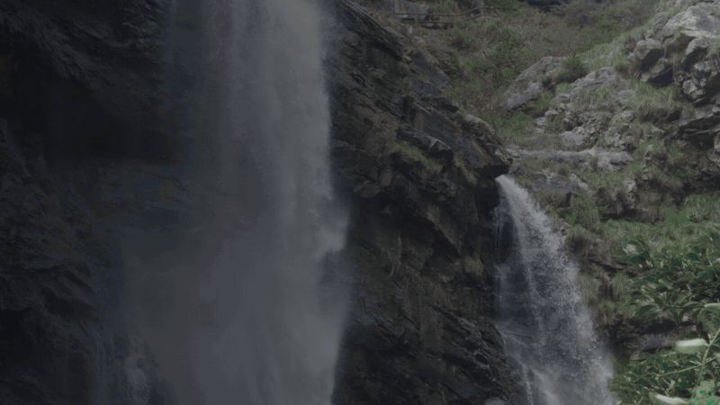
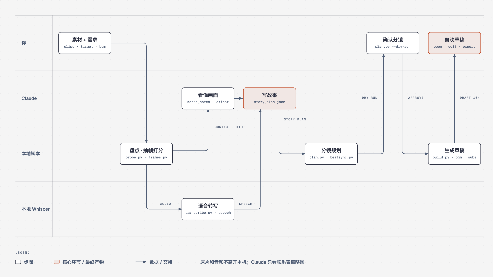

<h1 align="center">jianying-autocut</h1>

<p align="center"><a href="README.md">简体中文</a> | <b>English</b></p>

<p align="center">
  <b>Turn a folder of travel / vlog footage into a story-ordered rough-cut draft that JianYing Pro (剪映专业版) opens directly.</b><br>
  AI first understands the footage, then picks shots to a story and builds a JianYing draft with chapter titles, subtitles, voice-over and BGM. All you do is polish and export in JianYing.<br>
  Let Claude write the story, plan a shooting script before you go and cut to it afterwards, or record a voice-over first and let the pictures follow it.
</p>

<p align="center">
  
  
  <a href="https://www.python.org/"></a>
  
  <a href="https://github.com/BeenLi/jianying-autocut/actions/workflows/test.yml"></a>
  <a href="./LICENSE"></a>
</p>

https://github.com/user-attachments/assets/e7c27388-6343-4862-a71c-0ee0be00a2b0

<p align="center"><sub>60-second demo (in Chinese): 62 raw clips → inventory and scoring → Claude reads the frames, Whisper transcribes speech → story → shot plan → JianYing draft. The footage comes from a real hike on Mount Lu, with faces blurred.
⬇ <a href="https://github.com/BeenLi/jianying-autocut/raw/main/docs/promo/promo.mp4">Download mp4</a></sub></p>

<details>
<summary>No video player? Click here for the GIF version</summary>

</details>

---

## Three ways to use it

| Your situation | What you do | Where the story comes from | What sets the pace |
|:--|:--|:--|:--|
| Footage shot, no story in mind | Hand the folder to Claude | Claude writes one after reviewing the footage | Long/short shot rhythm (beat sync optional) |
| Not shot yet, or shot with your own story | Write a **shooting script** first (or tell Claude the story); cut to it afterwards | Your script; Claude matches footage to each shot | Long/short shot rhythm (beat sync optional) |
| You want a narrated vlog | Record the **voice-over** first (the script can hold a narration draft) | Your voice-over; Claude picks footage for each sentence | The voice-over |

All three share steps 1–3 (inventory, frame scoring, understanding the footage) and the final build step; they differ in how the story and shots are decided in between.

## Workflow

<p align="center">
  
</p>

| Step | What happens | Output (under `_autocut/`) |
|:--|:--|:--|
| **0&nbsp;Request**<br><sub>you</sub> | Footage folder, one-line background, BGM or not | — |
| **1&nbsp;Inventory**<br><sub>`probe.py`</sub> | Duration, resolution, capture time, silent stretches; clip IDs stay stable per file | `inventory.csv` |
| **2&nbsp;Frame scoring**<br><sub>`frames.py`</sub> | Key frame every 8 s, blur and exposure checks, contact sheets | `frames.csv` `contact/` |
| **3&nbsp;Understand footage**<br><sub>Claude · `transcribe.py` · `notes.py` · `orient.py`</sub> | Claude reads the contact sheets to write scene notes and check orientation; local Whisper transcribes speech at no extra charge | `footage_brief.md`, `orientation.json` |
| **4&nbsp;Write the story**<br><sub>Claude · `match.py`</sub> | Hook / setup / turn / climax / ending; drops unrelated footage; optional parallel montage. With a shooting script, Claude matches footage to shots instead and you confirm on the page | `story_plan.json` |
| **5&nbsp;Shot plan**<br><sub>`plan.py`</sub> | Keeps only key segments and lists what it drops, picks shots with a long/short rhythm, avoids bad frames, snaps to silence; dry-run first | `shots.csv` |
| **5.5&nbsp;Beat sync**<br><sub>`beatsync.py`</sub> | Optional: snaps cuts to beats and chapter changes to bars, can align the climax with a high-energy section of the song | `shots.csv`, `bgm_plan.json` |
| **6&nbsp;Build draft**<br><sub>`build.py`</sub> | Main video track + chapter titles + subtitles + voice-over + BGM, read back and self-checked after writing | JianYing draft |
| **7&nbsp;Polish and export**<br><sub>you</sub> | Color, transitions, subtitles and export in JianYing | Final video |


### Shooting script: write it before you go, cut to it afterwards

1. **Before shooting**: tell Claude where you are going, for how long and what the story is. It writes a shooting script:
   chapters, a shot list (shot size, length, tips), talking-to-camera points, and a narration draft per chapter if you want a
   voice-over film. The script is published as a Claude Artifact page only you can open.
2. **On location**: open the page on your phone, tick each shot as you get it and jot notes; add, edit or remove shots on the spot.
3. **After shooting**: steps 1–3 run as usual, and step 4 does not invent a story: Claude matches footage to each planned shot.
   Switch the same page to "剪辑" (edit) to see each match (with thumbnails), the shots you missed and good unplanned footage;
   confirm, swap footage, accept or reject, or ask for more ("add the bit where we got lost") and Claude goes looking.
   Once you are done, `match.py` writes `story_plan.json` and the rest runs as usual.

No script, just a story you told Claude? It turns that into the same page for you to confirm.

### Voice-over films: record first, pictures follow

1. **Record**: one long take (slips and retakes are fine) or one file per chapter. If the script has a narration draft, the page's
   "录音稿" (recording script) view works as a teleprompter.
2. **Transcribe and draft**: `transcribe.py --narration` transcribes sentence by sentence (with word timings) and
   `narrate.py --draft` builds a first draft: only the last take of a repeated sentence is kept, and with a narration draft the
   transcript is aligned to it sentence by sentence, so slips and chatter are skipped by default.
3. **Pick footage**: Claude chooses footage for each sentence and drops in live sound where it matters (talking to camera,
   cheering, waves); the voice-over pauses there. With the page, confirm, swap footage, fix timings or skip sentences in its edit view.
4. **Lay out the timeline**: `narrate.py` sets every shot's length from the voice-over and cuts the picture 0.3 s before each
   sentence starts (J-cut); pauses are shortened in proportion, cut in the middle so the room tone survives; the same clip never
   appears twice in a row. Run `--dry-run` first.
5. **Mix**: `build.py --narration` adds a voice-over track. Speech from each recording source is normalised to -16 LUFS, the
   footage's own sound sits underneath, and the music holds one steady ducked level for the whole film, rising only in long gaps
   or where you mark `up` and dropping out where you mark `drop`. Every sentence is checked to be at least 12 LU above the music.

Full rules in [`references/narration.md`](skills/jianying-autocut/references/narration.md) (Chinese).

## Features

| Feature | Status | Notes |
|---|---|---|
| Inventory footage, sort by capture time | ✅ | ffprobe; falls back to pymediainfo without it |
| Detect blurry / too dark / overexposed frames | ✅ | Laplacian variance compared with the clip's own median, so indoor or foggy clips are not thrown out wholesale |
| Orientation detection | ✅ | Claude checks the contact sheets: clips upside down throughout are rotated 180°; dangling, shaky or mostly tilted clips are dropped; the odd tilted frame is avoided |
| Footage understanding | ✅ | Frames sampled at fixed intervals and at scene changes, scene notes by Claude, speech transcribed by local Whisper |
| Story structure | ✅ | Cold-open hook, setup, turn, climax, ending; must-have moments (pins) are always included |
| Shooting-script page | ✅ | A Claude Artifact page that works on a phone: chapters, shot list, talking points, narration draft; tick, note, add, edit, remove; Claude never overwrites your edits |
| Cut to your own story | ✅ | Footage matched to shots automatically (from scene notes and speech), confirmed on the page; missed shots reported, good unplanned footage suggested |
| Drop unrelated footage | ✅ | `story.py --exclude c001-c010,…` |
| Parallel montage | ✅ | Two threads in one chapter (e.g. "the two of us" × "our parents") cut alternately, ending on the thread you choose |
| Long/short shot rhythm | ✅ | Roughly chronological within a chapter, locally reordered to avoid back-to-back long shots or three short shots in a row |
| Condensed footage, no length limit | ✅ | Keeps key segments by default, so the kept segments set the length; `--target` sets an exact length instead |
| Chapter titles | ✅ | 3 seconds of text at the start of each chapter |
| BGM | ✅ | Several tracks allowed; looped if shorter than the video, trimmed if longer, faded in and out |
| Speech subtitles | ✅ | Claude picks the meaningful lines and adds bottom subtitles on a dark box; the BGM ducks while people talk. For full captions use JianYing's "智能字幕" |
| Recorded narration | ✅ | Footage picked per sentence, live sound in the gaps, J-cuts; retakes and slips skipped automatically; subtitles from the voice-over |
| Speech / music loudness balance | ✅ | Measured with ffmpeg: speech normalised to -16 LUFS, one ducked music level for the whole film; sentences the music would bury are listed |
| AI voice-over (TTS) | ❌ | Not done |
| Transitions, color, speed ramps, filters | ❌ | Left to JianYing |
| Automatic export | ❌ | JianYing 7+ hides its export controls, so export is manual |

## Input and output

**Input**

- Footage folder: `.mp4` `.mov` `.m4v` `.mkv` `.avi` `.mts` `.m2ts` `.mxf` (subfolders are scanned recursively)
- A one-line background (helps with understanding the footage and reduces transcription errors); a target length (e.g. `5:00`) only if you want a fixed one
- BGM (optional): local `.mp3` / `.flac` / `.m4a` (NetEase Cloud Music `.ncm` files are encrypted and cannot be used)
- Voice-over recordings (voice-over films): `.m4a` `.mp3` `.wav` `.aac` `.flac`, one file or a folder (sorted by file name)
- Shooting script (optional): ask Claude for one before you go, keep the link and hand it back when you edit

**Output**: a JianYing Pro draft in JianYing's "Global settings → Draft location" (default `~/Movies/JianyingPro/User Data/Projects/com.lveditor.draft/<draft name>/`)

| File | Contents |
|---|---|
| `draft_info.json` | Draft body (plaintext JSON, version matching the local JianYing, `164.0.0` for 11.6): main video track, chapter-title text track, subtitle track (optional), voice-over audio track (voice-over films), BGM audio track |
| `draft_meta_info.json` | Draft metadata |

Footage is **not copied** into the draft; only absolute paths are recorded, so don't move or rename footage after building. JianYing encrypts these files itself the first time it opens them.

All intermediate files live in `<footage folder>/_autocut/`, and every step can be rerun on its own.

## Requirements

| Requirement | Notes |
|---|---|
| macOS | The draft encryption library only supports Windows, so this project writes plaintext drafts that JianYing for macOS encrypts on first open |
| JianYing Pro 11.6 (VideoFusion-macOS) | The version number is read from the local install each time, so JianYing upgrades need no code changes, but rerun the self-check after upgrading |
| Python ≥ 3.10 + [uv](https://docs.astral.sh/uv/) | Each script declares its dependencies in its header (PEP 723) and `uv run --script` installs them on first run: numpy, pillow, pymediainfo, pyJianYingDraft (pinned at commit `69cee12`) |
| ffmpeg / ffprobe | `brew install ffmpeg` recommended (needs `h264_videotoolbox` and `silencedetect`; voice-over films also use `ebur128` for loudness) |
| About 500 MB of disk space | Local Whisper small model, downloaded on the first transcription |
| Claude Code (or another coding agent that reads Agent Skills) | Orchestrates the steps and writes the story script |
| A claude.ai account (optional) | The shooting-script page is a Claude Artifact; open it on your phone signed in to claude.ai. Without it, edit the JSON directly |

## Install and use

Pick one of three ways:

```bash
# 1. skills CLI: copies the skill to ~/.claude/skills/jianying-autocut; update later with `npx skills update -g`
npx skills add BeenLi/jianying-autocut -g -a claude-code
```

```text
# 2. Claude Code plugin: run inside Claude Code; the skill name gets the plugin prefix (jianying-autocut:jianying-autocut)
/plugin marketplace add BeenLi/jianying-autocut
/plugin install jianying-autocut@jianying-autocut
```

```bash
# 3. git clone + symlink, for development: repo changes take effect immediately
git clone https://github.com/BeenLi/jianying-autocut.git && cd jianying-autocut
mkdir -p ~/.claude/skills
ln -sfn "$PWD/skills/jianying-autocut" ~/.claude/skills/jianying-autocut
```

The skills CLI copies only the `skills/jianying-autocut/` folder (skill instructions, scripts, vendored modules), without the promo video and design docs in `docs/`; the plugin clones the whole repo and reads the skill from that folder.

Then tell Claude Code:

```text
Cut the ~/Videos/my-trip folder into a travel vlog, keeping only the key segments. Background: a two-day hike. Use ~/Music/xxx.mp3 as BGM.
I'm going to Gouqi Island for two days next week. Write me a shooting script.
I'm back; the footage is in ~/Videos/gouqi. Cut it to the shooting script.
My voice-over is in ~/Voice/gouqi/ and the footage in ~/Videos/gouqi. Cut it to the voice-over, with ~/Music/xxx.mp3 as BGM.
```

You can also run the steps by hand (`S=~/.claude/skills/jianying-autocut/scripts`, `W=<footage folder>/_autocut`):

```bash
uv run --script $S/probe.py ~/Videos/my-trip
uv run --script $S/frames.py --work $W
uv run --script $S/transcribe.py --work $W --context "two-day hike" --language en     # default is zh; auto also works
# Claude reads the $W/contact/ sheets, writes $W/scene_notes.json, and checks orientation
uv run --script $S/notes.py --work $W
uv run --script $S/orient.py --work $W --flip c012 --bad c005@12
# Claude writes $W/story_plan.json (format in skills/jianying-autocut/references/story_plan.md)
uv run --script $S/story.py --work $W --check --exclude c001-c010
uv run --script $S/plan.py --work $W --dry-run     # add --target 5:00 for a fixed length
uv run --script $S/plan.py --work $W
# Fully quit JianYing with ⌘Q
uv run --script $S/build.py --work $W --name my-trip-rough-cut --titles --bgm ~/Music/xxx.mp3
```

For a voice-over film, replace everything after step 3 with:

```bash
uv run --script $S/transcribe.py --work $W --narration ~/Voice/my-trip/ --context "two-day hike"
uv run --script $S/narrate.py --work $W --draft          # add --script $W/narration_script.json if you have a narration draft
# Claude picks footage for each sentence in $W/narration_plan.json (format in skills/jianying-autocut/references/narration.md)
uv run --script $S/narrate.py --work $W --dry-run        # feels rushed? add --pause-ratio 0.8
uv run --script $S/narrate.py --work $W
# Fully quit JianYing with ⌘Q
uv run --script $S/build.py --work $W --name my-voiceover-cut --titles --narration $W/narration_track.json --bgm ~/Music/xxx.mp3
```

Run the tests: `./run_tests.sh`

## Current limitations

- **Once JianYing opens a draft it encrypts it, and this project cannot read it back.** The scripts can't see or build on edits you make in JianYing; rebuilding overwrites the draft folder of the same name, so save a copy in JianYing first if you want to keep manual edits. To keep working from an edited version, export the video from JianYing and feed it back in as footage.
- **JianYing must be fully quit (⌘Q) while the draft is written**, or it overwrites the draft when it exits.
- macOS + JianYing Pro only; CapCut is untested.
- Claude reads contact sheets (one frame every 8 seconds by default), so it misses action between frames; `frames.py --every 4` samples more densely.
- Claude cannot hear: speech comes from Whisper, and it cannot judge ambient sound or the mood of music; loudness in voice-over films is an ffmpeg measurement, not a judgement of how it sounds.
- Cut points only snap to silence, so talking-to-camera clips are occasionally cut mid-sentence.
- Orientation is sampled one frame every 8 seconds, so frames between samples can be missed.
- When several devices were used and their clocks weren't in sync, sorting by capture time goes wrong; fix capture times yourself first.
- When a chapter's footage is very fragmented (all short shots), rhythm adjustment can't avoid three short shots in a row.
- In voice-over films, whether JianYing 11.6 honours volumes above 100% written in the draft is not yet verified; the report lists those places, so listen to them once.
- Sentence boundaries come from Whisper and can be off by 0.2–0.5 s; the scripts only widen them, never narrow them, but you may still need to fix a timing on the page.
- Voice-over films are not beat-synced: the voice-over sets the length, and `beatsync.py` refuses to run.
- The shooting-script page needs a network connection and a claude.ai sign-in; shot order on the page only affects the script, and shots within a chapter are still ordered by capture time in the cut.
- Drafts contain video / text (chapter titles, subtitles) / voice-over / BGM tracks; transitions, color and effects are done in JianYing.

## Repository layout

```text
skills/jianying-autocut/                The skill itself (what npx skills / the plugin installs)
  SKILL.md                              Instructions for the agent (skill entry point)
  scripts/                              probe · frames · transcribe · notes · orient · story · match · plan · narrate · beatsync · loudness · build · common
  references/                           Story-writing guide (story_plan.md), shooting-script page (shoot_plan.md), voice-over films (narration.md), field-tested pitfalls (pitfalls.md)
  assets/                               Shooting-script page template (shoot_plan_page.html)
  vendor/video-script-refs/             Vendored directing-method docs from video-script (MIT, see Acknowledgements)
.claude-plugin/marketplace.json         Claude Code plugin manifest
tests/                                  pytest (./run_tests.sh)
docs/                                   Design spec, implementation plans, workflow diagram, promo video
```

Skill instructions and docs are written in Chinese.

## Acknowledgements

- **[GuanYixuan/pyJianYingDraft](https://github.com/GuanYixuan/pyJianYingDraft)** (Apache-2.0): Python library for generating JianYing drafts, the foundation for writing drafts here.
- **[aoguai/pyJianYingDraft](https://github.com/aoguai/pyJianYingDraft)** (Apache-2.0): maintained fork supporting the new draft format of JianYing 7+ / 11.6; this project pins its commit `69cee12`.
- **[zenstory-ai/video-recap-skills](https://github.com/zenstory-ai/video-recap-skills)** (MIT, © 2026 PiteChen): this project vendors the directing-method document from `video-script`. License text in [`vendor/LICENSE-video-recap-skills`](skills/jianying-autocut/vendor/LICENSE-video-recap-skills).
- **[cathrynlavery/diagram-design](https://github.com/cathrynlavery/diagram-design)** (MIT): the workflow diagram uses its design system.
- **[faster-whisper](https://github.com/SYSTRAN/faster-whisper)** (MIT): local speech transcription.
- **[FFmpeg](https://ffmpeg.org/)** (LGPL/GPL, installed on your system, not distributed with this project): inventory, silence detection, EBU R128 loudness measurement.
- The online tutorial 《剪映自动化粗剪 · 即抄提示词（适配剪映 11.6）》 (JianYing automated rough cut, copy-paste prompts for 11.6): source of lessons on version alignment, zero-copy footage and other pitfalls.

## License

The code is released under [MIT](LICENSE); vendored code under `vendor/` keeps its original MIT license.
