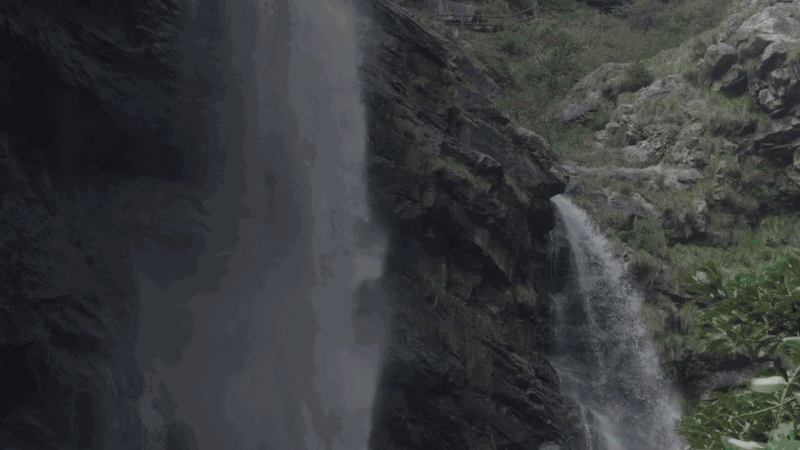

<h1 align="center">jianying-autocut</h1>

<p align="center"><a href="README.md">简体中文</a> | <b>English</b></p>

<p align="center">
  <b>Turn a folder of travel / vlog footage into a story-ordered rough-cut draft that JianYing Pro (剪映专业版) opens directly.</b><br>
  AI first understands the footage, then writes a story script, then picks shots to a rhythm and builds a JianYing draft with chapter titles and BGM. All you do is polish and export in JianYing.
</p>

<p align="center">
  
  
  <a href="https://www.python.org/"></a>
  <a href="https://platform.xiaomimimo.com"></a>
  
  <a href="https://github.com/BeenLi/jianying-autocut/actions/workflows/test.yml"></a>
  <a href="./LICENSE"></a>
</p>

https://github.com/user-attachments/assets/e7c27388-6343-4862-a71c-0ee0be00a2b0

<p align="center"><sub>60-second demo (in Chinese): 62 raw clips → inventory and scoring → MiMo understands the footage → story → shot plan → JianYing draft. The footage comes from a real hike on Mount Lu, with faces blurred.
⬇ <a href="https://github.com/BeenLi/jianying-autocut/raw/main/docs/promo/promo.mp4">Download mp4</a></sub></p>

<details>
<summary>No video player? Click here for the GIF version</summary>

</details>

---

## Workflow

<p align="center">
  
</p>

| Step | What happens | Output (under `_autocut/`) |
|:--|:--|:--|
| **0&nbsp;Request**<br><sub>you</sub> | Footage folder, target length, one-line background, BGM or not | — |
| **1&nbsp;Inventory**<br><sub>`probe.py`</sub> | Duration, resolution, capture time, silent stretches; clip IDs stay stable per file | `inventory.csv` |
| **2&nbsp;Frame scoring**<br><sub>`frames.py`</sub> | Key frame every 8 s, blur and exposure checks, contact sheets | `frames.csv` `contact/` |
| **3&nbsp;Understand footage**<br><sub>MiMo · `understand.py`</sub> | Joins everything into one 720p proxy and runs once: scene descriptions + speech transcription, then splits back per clip; per-thumbnail orientation check | `clip_understanding.json` |
| **4&nbsp;Write the story**<br><sub>Claude</sub> | Hook / setup / turn / climax / ending; drops unrelated footage; optional parallel montage | `story_plan.json` |
| **5&nbsp;Shot plan**<br><sub>`plan.py`</sub> | Allocates time, picks shots with a long/short rhythm, avoids bad frames, snaps to silence, microsecond-exact; dry-run first | `shots.csv` |
| **6&nbsp;Build draft**<br><sub>`build.py`</sub> | Main video track + chapter titles + BGM, read back and self-checked after writing | JianYing draft |
| **7&nbsp;Polish and export**<br><sub>you</sub> | Color, transitions, subtitles and export in JianYing | Final video |

Without a MiMo key (or with too little balance) it **reminds you to top up**; you can also pass `--no-understanding` for the fallback path, where Claude writes the story straight from the `contact/` sheets.

## Features

| Feature | Status | Notes |
|---|---|---|
| Inventory footage, sort by capture time | ✅ | ffprobe; falls back to pymediainfo without it |
| Detect blurry / too dark / overexposed frames | ✅ | Laplacian variance compared with the clip's own median, so indoor or foggy clips are not thrown out wholesale |
| Orientation detection | ✅ | MiMo checks frame by frame: clips upside down throughout are rotated 180°; dangling, shaky or mostly tilted clips are dropped; the odd tilted frame is avoided |
| Scene-level footage understanding | ✅ | Scene description + speech transcript for every clip (MiMo VLM / ASR) |
| Story structure | ✅ | Cold-open hook, setup, turn, climax, ending; must-have moments (pins) are always included |
| Drop unrelated footage | ✅ | `story.py --exclude c001-c010,…` |
| Parallel montage | ✅ | Two threads in one chapter (e.g. "the two of us" × "our parents") cut alternately, ending on the thread you choose |
| Long/short shot rhythm | ✅ | Roughly chronological within a chapter, locally reordered to avoid back-to-back long shots or three short shots in a row |
| Exact final length | ✅ | Integer microseconds, no gaps or overlaps between shots |
| Chapter titles | ✅ | 3 seconds of text at the start of each chapter |
| BGM | ✅ | Several tracks allowed; looped if shorter than the video, trimmed if longer, faded in and out |
| Speech subtitles | ❌ | Not done. Use JianYing's "智能字幕" (auto captions) for one-click subtitles |
| AI voice-over / narration | ❌ | Not done (`build.py` already reserves narration / subtitle track hooks) |
| Transitions, color, speed ramps, filters | ❌ | Left to JianYing |
| Automatic export | ❌ | JianYing 7+ hides its export controls, so export is manual |

## Input and output

**Input**

- Footage folder: `.mp4` `.mov` `.m4v` `.mkv` `.avi` `.mts` `.m2ts` `.mxf` (subfolders are scanned recursively)
- Target length (e.g. `5:00`) and a one-line background (helps MiMo understand the footage)
- BGM (optional): local `.mp3` / `.flac` / `.m4a` (NetEase Cloud Music `.ncm` files are encrypted and cannot be used)

**Output**: a JianYing Pro draft in JianYing's "Global settings → Draft location" (default `~/Movies/JianyingPro/User Data/Projects/com.lveditor.draft/<draft name>/`)

| File | Contents |
|---|---|
| `draft_info.json` | Draft body (plaintext JSON, version matching the local JianYing, `164.0.0` for 11.6): main video track, chapter-title text track, BGM audio track |
| `draft_meta_info.json` | Draft metadata |

Footage is **not copied** into the draft; only absolute paths are recorded, so don't move or rename footage after building. JianYing encrypts these files itself the first time it opens them.

All intermediate files live in `<footage folder>/_autocut/`, and every step can be rerun on its own.

## Requirements

| Requirement | Notes |
|---|---|
| macOS | The draft encryption library only supports Windows, so this project writes plaintext drafts that JianYing for macOS encrypts on first open |
| JianYing Pro 11.6 (VideoFusion-macOS) | The version number is read from the local install each time, so JianYing upgrades need no code changes, but rerun the self-check after upgrading |
| Python ≥ 3.10 + [uv](https://docs.astral.sh/uv/) | Each script declares its dependencies in its header (PEP 723) and `uv run --script` installs them on first run: numpy, pillow, pymediainfo, pyJianYingDraft (pinned at commit `69cee12`) |
| ffmpeg / ffprobe | `brew install ffmpeg` recommended (needs `h264_videotoolbox` and `silencedetect`) |
| Xiaomi MiMo API key (optional) | `export MIMO_API_KEY=…`; used for footage understanding and orientation detection. Default vision model `mimo-v2.6-flash`, override with `MIMO_MODEL` |
| Claude Code (or another coding agent that reads Agent Skills) | Orchestrates the steps and writes the story script |

## Install and use

Pick one of three ways:

```bash
# 1. skills CLI: copies the skill to ~/.claude/skills/jianying-autocut; update later with `npx skills update -g`
npx skills add BeenLi/jianying-autocut -g -a claude-code
```

```text
# 2. Claude Code plugin: run inside Claude Code; the skill name gets the plugin prefix (jianying-autocut:jianying-autocut)
/plugin marketplace add BeenLi/jianying-autocut
/plugin install jianying-autocut@jianying-autocut
```

```bash
# 3. git clone + symlink, for development: repo changes take effect immediately
git clone https://github.com/BeenLi/jianying-autocut.git && cd jianying-autocut
mkdir -p ~/.claude/skills
ln -sfn "$PWD/skills/jianying-autocut" ~/.claude/skills/jianying-autocut
```

The skills CLI copies only the `skills/jianying-autocut/` folder (skill instructions, scripts, vendored modules), without the promo video and design docs in `docs/`; the plugin clones the whole repo and reads the skill from that folder.

Then tell Claude Code:

```text
Cut the ~/Videos/my-trip folder into a 5-minute travel vlog. Background: a two-day hike. Use ~/Music/xxx.mp3 as BGM.
```

You can also run the steps by hand (`S=~/.claude/skills/jianying-autocut/scripts`, `W=<footage folder>/_autocut`):

```bash
uv run --script $S/probe.py ~/Videos/my-trip
uv run --script $S/frames.py --work $W
uv run --script $S/understand.py --work $W --context "two-day hike"     # or --no-understanding
# Claude writes $W/recap_story_plan.json (format in skills/jianying-autocut/references/story_plan.md)
uv run --script $S/story.py --work $W --from-recap --exclude c001-c010
uv run --script $S/plan.py --work $W --target 5:00 --dry-run
uv run --script $S/plan.py --work $W --target 5:00
# Fully quit JianYing with ⌘Q
uv run --script $S/build.py --work $W --name my-trip-rough-cut --titles --bgm ~/Music/xxx.mp3
```

Run the tests: `./run_tests.sh`

## Current limitations

- **Once JianYing opens a draft it encrypts it, and this project cannot read it back.** The scripts can't see or build on edits you make in JianYing; rebuilding overwrites the draft folder of the same name, so save a copy in JianYing first if you want to keep manual edits. To keep working from an edited version, export the video from JianYing and feed it back in as footage.
- **JianYing must be fully quit (⌘Q) while the draft is written**, or it overwrites the draft when it exits.
- macOS + JianYing Pro only; CapCut is untested.
- Footage understanding relies on Xiaomi MiMo (pay per use): each run joins all footage into one proxy and runs once; without MiMo only the contact-sheet fallback is available.
- MiMo transcription is cut into rough 15-second windows without sentence boundaries; cut points can only snap to silence, so talking-to-camera clips are occasionally cut mid-sentence.
- Orientation is sampled one frame every 8 seconds, so frames between samples can be missed.
- When several devices were used and their clocks weren't in sync, sorting by capture time goes wrong; fix capture times yourself first.
- When a chapter's footage is very fragmented (all short shots), rhythm adjustment can't avoid three short shots in a row.
- Drafts contain only video / text / BGM tracks; subtitles, voice-over, transitions and color are done in JianYing.

## Repository layout

```text
skills/jianying-autocut/                The skill itself (what npx skills / the plugin installs)
  SKILL.md                              Instructions for the agent (skill entry point)
  scripts/                              probe · frames · understand · story · plan · build · common
  references/                           Story-writing guide (story_plan.md), field-tested pitfalls (pitfalls.md)
  vendor/video-understanding/           Vendored footage-understanding module (MIT, see Acknowledgements)
  vendor/video-script-refs/             Directing method docs from video-script (MIT)
.claude-plugin/marketplace.json         Claude Code plugin manifest
tests/                                  pytest (./run_tests.sh)
docs/                                   Design spec, implementation plans, workflow diagram, promo video
```

Skill instructions and docs are written in Chinese.

## Acknowledgements

- **[GuanYixuan/pyJianYingDraft](https://github.com/GuanYixuan/pyJianYingDraft)** (Apache-2.0): Python library for generating JianYing drafts, the foundation for writing drafts here.
- **[aoguai/pyJianYingDraft](https://github.com/aoguai/pyJianYingDraft)** (Apache-2.0): maintained fork supporting the new draft format of JianYing 7+ / 11.6; this project pins its commit `69cee12`.
- **[zenstory-ai/video-recap-skills](https://github.com/zenstory-ai/video-recap-skills)** (MIT, © 2026 PiteChen): this project vendors its `video-understanding` (scenes, ASR, VLM, understanding brief) and follows the story-script format and directing method of `video-script`. License text in [`vendor/LICENSE-video-recap-skills`](skills/jianying-autocut/vendor/LICENSE-video-recap-skills).
- **[cathrynlavery/diagram-design](https://github.com/cathrynlavery/diagram-design)** (MIT): the workflow diagram uses its design system.
- **[Xiaomi MiMo](https://platform.xiaomimimo.com)**: the VLM / ASR models used for footage understanding.
- The online tutorial 《剪映自动化粗剪 · 即抄提示词（适配剪映 11.6）》 (JianYing automated rough cut, copy-paste prompts for 11.6): source of lessons on version alignment, zero-copy footage and other pitfalls.

## License

The code is released under [MIT](LICENSE); vendored code under `vendor/` keeps its original MIT license.
