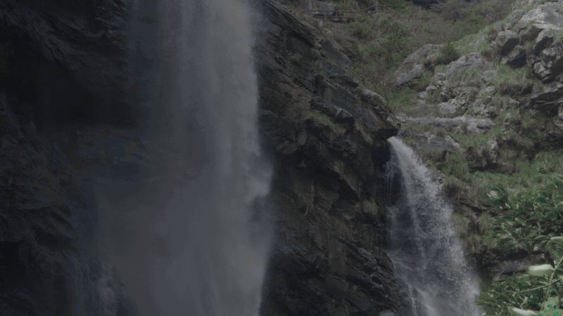
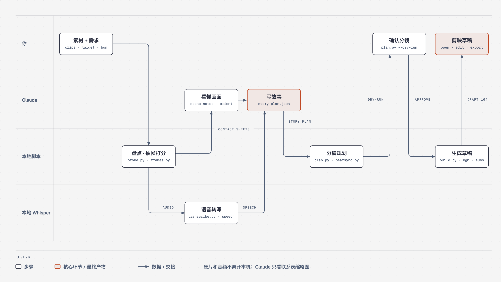

<h1 align="center">jianying-autocut</h1>

<p align="center"><b>简体中文</b> | <a href="README.en.md">English</a></p>

<p align="center">
  <b>把一个装满旅行 / vlog 素材的文件夹，变成剪映专业版能直接打开、按故事排好的粗剪草稿。</b><br>
  先让 AI 看懂素材，再写故事脚本，最后按节奏自动挑镜头、生成带章节标题和 BGM 的剪映草稿。你只需要在剪映里精修和导出。
</p>

<p align="center">
  
  
  <a href="https://www.python.org/"></a>
  
  <a href="https://github.com/BeenLi/jianying-autocut/actions/workflows/test.yml"></a>
  <a href="./LICENSE"></a>
</p>

https://github.com/user-attachments/assets/e7c27388-6343-4862-a71c-0ee0be00a2b0

<p align="center"><sub>60 秒演示：62 段原始素材 → 盘点打分 → MiMo 看懂素材 → 写故事 → 分镜 → 剪映草稿。演示素材来自一次真实的庐山徒步，人脸已打码。
⬇ <a href="https://github.com/BeenLi/jianying-autocut/raw/main/docs/promo/promo.mp4">下载 mp4</a></sub></p>

<details>
<summary>看不到播放器？点这里看 GIF 版</summary>

</details>

---

## 工作流

<p align="center">
  
</p>

| 步骤 | 做什么 | 产出（`_autocut/` 下） |
|:--|:--|:--|
| **0&nbsp;提需求**<br><sub>你</sub> | 素材目录、一句话背景、要不要 BGM | — |
| **1&nbsp;盘点**<br><sub>`probe.py`</sub> | 时长、分辨率、拍摄时间、静音段；编号随文件稳定 | `inventory.csv` |
| **2&nbsp;抽帧打分**<br><sub>`frames.py`</sub> | 每 8 秒抽关键帧，判糊、判曝光，拼联系表 | `frames.csv` `contact/` |
| **3&nbsp;看懂素材**<br><sub>Claude · `transcribe.py` · `notes.py` · `orient.py`</sub> | Claude 看联系表写场景描述、判方向；本地 Whisper 转写语音，不额外收费 | `footage_brief.md`、`orientation.json` |
| **4&nbsp;写故事**<br><sub>Claude</sub> | 钩子 / 铺垫 / 转折 / 高潮 / 收尾；剔除无关素材；可选平行蒙太奇 | `story_plan.json` |
| **5&nbsp;分镜**<br><sub>`plan.py`</sub> | 只留关键片段并列出删除清单，按长短节奏挑镜头，避坏帧、吸附静音；先 dry-run | `shots.csv` |
| **5.5&nbsp;卡点**<br><sub>`beatsync.py`</sub> | 可选：切点吸附拍点，章节交界落在小节线，可把高潮对到音乐高能段 | `shots.csv`、`bgm_plan.json` |
| **6&nbsp;生成草稿**<br><sub>`build.py`</sub> | 主视频轨 + 章节标题 + BGM，写完读回自检 | 剪映草稿 |
| **7&nbsp;精修导出**<br><sub>你</sub> | 剪映里调色、转场、字幕、导出成片 | 成片 |


## 支持的功能

| 功能 | 状态 | 说明 |
|---|---|---|
| 素材盘点、按拍摄时间排序 | ✅ | ffprobe；没有 ffprobe 时退回 pymediainfo |
| 糊片 / 过暗 / 过曝识别 | ✅ | 拉普拉斯方差与本段中位数比较，室内、雾天不会被整段误杀 |
| 画面方向检测 | ✅ | Claude 看联系表判断：整段倒装的转 180°；挂着晃拍、大半歪倒的整段弃用；个别歪帧避开 |
| 理解素材 | ✅ | 按固定间隔和画面切换抽帧，Claude 写场景描述，本地 Whisper 转写语音 |
| 梳理故事线 | ✅ | 钩子冷开场、铺垫、转折、高潮、收尾；必须出现的瞬间（pin）一定入选 |
| 剔除无关素材 | ✅ | `story.py --exclude c001-c010,…` |
| 平行蒙太奇 | ✅ | 章节里两条线（如「我们俩」×「爸妈」）交替剪，落在指定的那条线 |
| 长短镜头节奏 | ✅ | 章内大体按时间，局部调整避免连续长镜头 / 三连短镜头 |
| 精简素材，时长不设限 | ✅ | 默认只留关键片段，时长由留下的片段决定；也可用 `--target` 指定，精确到微秒 |
| 章节标题 | ✅ | 每章开头 3 秒文字 |
| BGM | ✅ | 多首可选；短于成片自动循环、长于成片截断、首尾淡入淡出 |
| 人声字幕 | ✅ | Claude 挑出有意义的人声配底部字幕（带底色），说话时 BGM 自动压低；全片逐句字幕仍用剪映「智能字幕」 |
| AI 配音 / 旁白 | ❌ | 未做 |
| 转场、调色、变速、滤镜 | ❌ | 交给剪映 |
| 自动导出成片 | ❌ | 剪映 7+ 隐藏了导出控件，只能手动导出 |

## 输入与输出

**输入**

- 素材目录：`.mp4` `.mov` `.m4v` `.mkv` `.avi` `.mts` `.m2ts` `.mxf`（子目录会递归扫描）
- 一句话背景（帮助理解素材，也减少转写的同音字错误）；想要固定时长时再给目标时长（如 `5:00`）
- BGM（可选）：本地 `.mp3` / `.flac` / `.m4a`（网易云 `.ncm` 是加密格式，不能用）

**输出**：剪映专业版草稿，位于剪映「全局设置 → 草稿位置」（默认 `~/Movies/JianyingPro/User Data/Projects/com.lveditor.draft/<草稿名>/`）

| 文件 | 内容 |
|---|---|
| `draft_info.json` | 草稿正文（明文 JSON，版本号与本机剪映一致，11.6 为 `164.0.0`）：主视频轨、章节标题文字轨、BGM 音频轨 |
| `draft_meta_info.json` | 草稿元数据 |

素材**不复制**进草稿，只记录绝对路径：生成后不要移动或改名素材。剪映首次打开时会自行加密这些文件。

中间产物全部在 `<素材目录>/_autocut/`，任何一步都能单独重跑。

## 环境依赖

| 依赖 | 说明 |
|---|---|
| macOS | 草稿加解密库只支持 Windows，本项目写明文草稿，由 macOS 版剪映首次打开时加密 |
| 剪映专业版 11.6（VideoFusion-macOS） | 版本号每次从本机读取，剪映升级后无需改代码，但建议升级后重跑一次自检 |
| Python ≥ 3.10 + [uv](https://docs.astral.sh/uv/) | 每个脚本头部写了依赖（PEP 723），`uv run --script` 首次运行自动安装：numpy、pillow、pymediainfo、pyJianYingDraft（锁定提交 `69cee12`） |
| ffmpeg / ffprobe | 推荐 `brew install ffmpeg`（需要 `h264_videotoolbox`、`silencedetect`） |
| 磁盘空间约 500MB | 本地 Whisper small 模型，首次转写时自动下载 |
| Claude Code（或其他能读 Agent Skills 的编程 Agent） | 负责编排各步、写故事脚本 |

## 安装与使用

三种方式任选其一：

```bash
# 1. skills CLI：把技能复制到 ~/.claude/skills/jianying-autocut；以后用 `npx skills update -g` 更新
npx skills add BeenLi/jianying-autocut -g -a claude-code
```

```text
# 2. Claude Code 插件：在 Claude Code 里运行；技能名会带插件前缀（jianying-autocut:jianying-autocut）
/plugin marketplace add BeenLi/jianying-autocut
/plugin install jianying-autocut@jianying-autocut
```

```bash
# 3. git clone + 软链，适合开发：改了仓库立即生效
git clone https://github.com/BeenLi/jianying-autocut.git && cd jianying-autocut
mkdir -p ~/.claude/skills
ln -sfn "$PWD/skills/jianying-autocut" ~/.claude/skills/jianying-autocut
```

skills CLI 只复制 `skills/jianying-autocut/` 这一个文件夹（技能说明、脚本、收录的 vendor 模块），不带 `docs/` 里的宣传片和设计文档；插件会克隆整个仓库，再从这个文件夹读取技能。

然后在 Claude Code 里说：

```text
把 ~/Videos/my-trip 这个文件夹剪成旅行 vlog，只留关键片段，背景是两天徒步，配 ~/Music/xxx.mp3。
```

也可以手动逐步运行（`S=~/.claude/skills/jianying-autocut/scripts`，`W=<素材目录>/_autocut`）：

```bash
uv run --script $S/probe.py ~/Videos/my-trip
uv run --script $S/frames.py --work $W
uv run --script $S/transcribe.py --work $W --context "两天徒步"
# Claude 看 $W/contact/ 联系表，写 $W/scene_notes.json，判断方向
uv run --script $S/notes.py --work $W
uv run --script $S/orient.py --work $W --flip c012 --bad c005@12
# Claude 写 $W/story_plan.json（格式见 skills/jianying-autocut/references/story_plan.md）
uv run --script $S/story.py --work $W --check --exclude c001-c010
uv run --script $S/plan.py --work $W --dry-run     # 要固定时长就加 --target 5:00
uv run --script $S/plan.py --work $W
# ⌘Q 完全退出剪映
uv run --script $S/build.py --work $W --name 我的旅行粗剪 --titles --bgm ~/Music/xxx.mp3
```

跑测试：`./run_tests.sh`

## 当前限制

- **剪映打开后草稿会被加密，本项目读不回来。** 你在剪映里做的修改，脚本看不到也接不上；重新生成会整目录覆盖同名草稿，想保留手工修改要先在剪映里另存副本。要基于剪好的版本继续处理，只能等你从剪映导出成片，再把成片当素材交给流程。
- **写草稿时剪映必须完全退出**（⌘Q），否则剪映退出时会覆盖草稿。
- 只支持 macOS + 剪映专业版；CapCut 未测试。
- Claude 看的是联系表（默认每 8 秒一帧），两帧之间的动作看不到；可以用 `frames.py --every 4` 抽得更密。
- Claude 听不到声音：语音靠 Whisper 转写，环境声和音乐的情绪都听不出来。
- 切点只吸附到静音处，对着镜头说话的片段偶尔会切在半句。
- 画面方向按 8 秒一帧抽样判断，抽样之间的画面可能漏判。
- 多台设备混拍时，若设备时钟没对齐，按拍摄时间的排序会乱；请先自行校正拍摄时间。
- 章节素材很碎时（全是短镜头），节奏调整也避免不了三连短镜头。
- 草稿只含视频 / 文字（章节标题、人声字幕）/ BGM 三类轨道；配音、转场、调色都在剪映里完成。

## 目录结构

```text
skills/jianying-autocut/                技能本体（npx skills / 插件安装的就是这个文件夹）
  SKILL.md                              给 Agent 的使用说明（技能入口）
  scripts/                              probe · frames · transcribe · notes · orient · story · plan · beatsync · build · common
  references/                           写故事指引（story_plan.md）、实测踩坑（pitfalls.md）
  vendor/video-script-refs/             收录的导演方法文档（MIT，见下方鸣谢）
  vendor/video-script-refs/             video-script 的导演方法文档（MIT）
.claude-plugin/marketplace.json         Claude Code 插件清单
tests/                                  pytest（./run_tests.sh）
docs/                                   设计规格、实现计划、工作流图、宣传片
```

## 鸣谢

- **[GuanYixuan/pyJianYingDraft](https://github.com/GuanYixuan/pyJianYingDraft)**（Apache-2.0）：Python 剪映草稿生成库，本项目写草稿的基础。
- **[aoguai/pyJianYingDraft](https://github.com/aoguai/pyJianYingDraft)**（Apache-2.0）：维护版，支持剪映 7+ / 11.6 的新草稿格式；本项目锁定使用其提交 `69cee12`。
- **[zenstory-ai/video-recap-skills](https://github.com/zenstory-ai/video-recap-skills)**（MIT, © 2026 PiteChen）：本项目收录了 `video-script` 的导演方法文档。许可证原文见 [`vendor/LICENSE-video-recap-skills`](skills/jianying-autocut/vendor/LICENSE-video-recap-skills)。
- **[cathrynlavery/diagram-design](https://github.com/cathrynlavery/diagram-design)**（MIT）：工作流图用它的设计系统绘制。
- **[faster-whisper](https://github.com/SYSTRAN/faster-whisper)**（MIT）：本地语音转写。
- 网络教程《剪映自动化粗剪 · 即抄提示词（适配剪映 11.6）》：版本号对齐、素材零复制等踩坑经验的来源。

## 许可证

本项目代码以 [MIT](LICENSE) 发布；`vendor/` 下的收录代码保留其原始 MIT 许可证。
