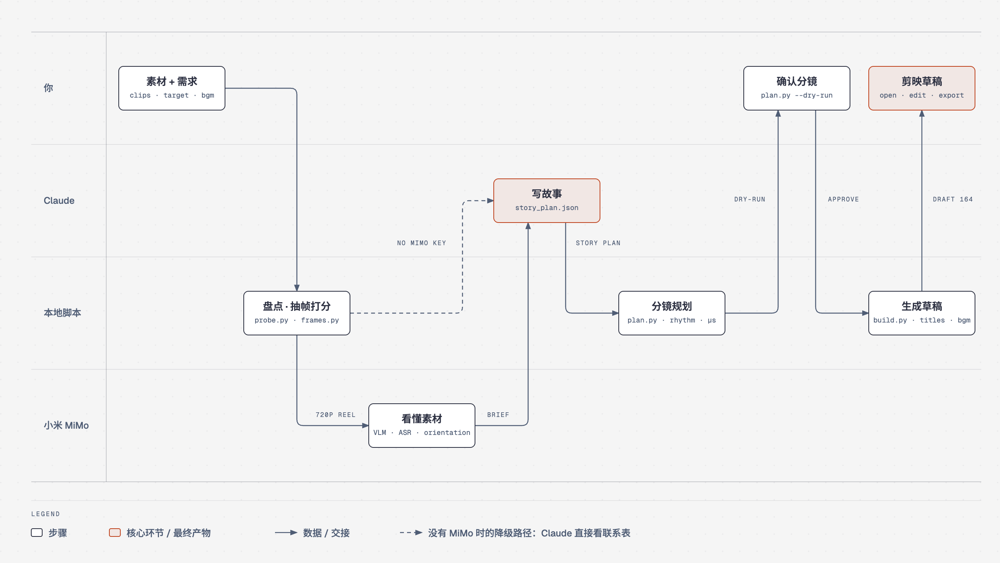

<h1 align="center">jianying-autocut</h1>

<p align="center">
  <b>把一个装满旅行 / vlog 素材的文件夹，变成剪映专业版能直接打开、按故事排好的粗剪草稿。</b><br>
  先让 AI 看懂素材，再写故事脚本，最后按节奏自动挑镜头、生成带章节标题和 BGM 的剪映草稿。你只需要在剪映里精修和导出。
</p>

<p align="center">
  
  
  <a href="https://www.python.org/"></a>
  <a href="https://platform.xiaomimimo.com"></a>
  
  <a href="./LICENSE"></a>
</p>

---

## 工作流

<p align="center">
  
</p>

| 步骤 | 做什么 | 产出（`_autocut/` 下） |
|:--|:--|:--|
| **0&nbsp;提需求**<br><sub>你</sub> | 素材目录、目标时长、一句话背景、要不要 BGM | — |
| **1&nbsp;盘点**<br><sub>`probe.py`</sub> | 时长、分辨率、拍摄时间、静音段；编号随文件稳定 | `inventory.csv` |
| **2&nbsp;抽帧打分**<br><sub>`frames.py`</sub> | 每 8 秒抽关键帧，判糊、判曝光，拼联系表 | `frames.csv` `contact/` |
| **3&nbsp;看懂素材**<br><sub>MiMo · `understand.py`</sub> | 拼成 720p 代理长片只跑一次：场景描述 + 语音转写，再拆回每段；逐帧判方向 | `clip_understanding.json` |
| **4&nbsp;写故事**<br><sub>Claude</sub> | 钩子 / 铺垫 / 转折 / 高潮 / 收尾；剔除无关素材；可选平行蒙太奇 | `story_plan.json` |
| **5&nbsp;分镜**<br><sub>`plan.py`</sub> | 分配时长，按长短节奏挑镜头，避坏帧、吸附静音，精确到微秒；先 dry-run | `shots.csv` |
| **6&nbsp;生成草稿**<br><sub>`build.py`</sub> | 主视频轨 + 章节标题 + BGM，写完读回自检 | 剪映草稿 |
| **7&nbsp;精修导出**<br><sub>你</sub> | 剪映里调色、转场、字幕、导出成片 | 成片 |

没有 MiMo key（或余额不足）时会**提醒你充值**；也可以加 `--no-understanding` 走降级路径：Claude 直接看 `contact/` 联系表写故事。

## 支持的功能

| 功能 | 状态 | 说明 |
|---|---|---|
| 素材盘点、按拍摄时间排序 | ✅ | ffprobe；没有 ffprobe 时退回 pymediainfo |
| 糊片 / 过暗 / 过曝识别 | ✅ | 拉普拉斯方差与本段中位数比较，室内、雾天不会被整段误杀 |
| 画面方向检测 | ✅ | MiMo 逐帧判断：整段倒装的转 180°；挂着晃拍、大半歪倒的整段弃用；个别歪帧避开 |
| 按场景理解素材 | ✅ | 每段素材的场景描述 + 语音转写（MiMo VLM / ASR） |
| 梳理故事线 | ✅ | 钩子冷开场、铺垫、转折、高潮、收尾；必须出现的瞬间（pin）一定入选 |
| 剔除无关素材 | ✅ | `story.py --exclude c001-c010,…` |
| 平行蒙太奇 | ✅ | 章节里两条线（如「我们俩」×「爸妈」）交替剪，落在指定的那条线 |
| 长短镜头节奏 | ✅ | 章内大体按时间，局部调整避免连续长镜头 / 三连短镜头 |
| 精确成片时长 | ✅ | 整数微秒，镜头间零缝隙零重叠 |
| 章节标题 | ✅ | 每章开头 3 秒文字 |
| BGM | ✅ | 多首可选；短于成片自动循环、长于成片截断、首尾淡入淡出 |
| 语音字幕 | ❌ | 未做。在剪映里用「智能字幕」一键生成 |
| AI 配音 / 旁白 | ❌ | 未做（`build.py` 已预留旁白 / 字幕轨接口） |
| 转场、调色、变速、滤镜 | ❌ | 交给剪映 |
| 自动导出成片 | ❌ | 剪映 7+ 隐藏了导出控件，只能手动导出 |

## 输入与输出

**输入**

- 素材目录：`.mp4` `.mov` `.m4v` `.mkv` `.avi` `.mts` `.m2ts` `.mxf`（子目录会递归扫描）
- 目标时长（如 `5:00`）、一句话背景（帮 MiMo 理解）
- BGM（可选）：本地 `.mp3` / `.flac` / `.m4a`（网易云 `.ncm` 是加密格式，不能用）

**输出**：剪映专业版草稿，位于剪映「全局设置 → 草稿位置」（默认 `~/Movies/JianyingPro/User Data/Projects/com.lveditor.draft/<草稿名>/`）

| 文件 | 内容 |
|---|---|
| `draft_info.json` | 草稿正文（明文 JSON，版本号与本机剪映一致，11.6 为 `164.0.0`）：主视频轨、章节标题文字轨、BGM 音频轨 |
| `draft_meta_info.json` | 草稿元数据 |

素材**不复制**进草稿，只记录绝对路径：生成后不要移动或改名素材。剪映首次打开时会自行加密这些文件。

中间产物全部在 `<素材目录>/_autocut/`，任何一步都能单独重跑。

## 环境依赖

| 依赖 | 说明 |
|---|---|
| macOS | 草稿加解密库只支持 Windows，本项目写明文草稿，由 macOS 版剪映首次打开时加密 |
| 剪映专业版 11.6（VideoFusion-macOS） | 版本号每次从本机读取，剪映升级后无需改代码，但建议升级后重跑一次自检 |
| Python ≥ 3.10 + [uv](https://docs.astral.sh/uv/) | 每个脚本头部写了依赖（PEP 723），`uv run --script` 首次运行自动安装：numpy、pillow、pymediainfo、pyJianYingDraft（锁定提交 `69cee12`） |
| ffmpeg / ffprobe | 推荐 `brew install ffmpeg`（需要 `h264_videotoolbox`、`silencedetect`） |
| 小米 MiMo API key（可选） | `export MIMO_API_KEY=…`；用于看懂素材和方向检测。默认看图模型 `mimo-v2.6-flash`，可用 `MIMO_MODEL` 覆盖 |
| Claude Code（或其他能读 Agent Skills 的编程 Agent） | 负责编排各步、写故事脚本 |

## 安装与使用

```bash
git clone https://github.com/BeenLi/jianying-autocut.git ~/.claude/skills/jianying-autocut
```

然后在 Claude Code 里说：

```text
把 ~/Videos/my-trip 这个文件夹剪成 5 分钟的旅行 vlog，背景是两天徒步，配 ~/Music/xxx.mp3。
```

也可以手动逐步运行（`S=~/.claude/skills/jianying-autocut/scripts`，`W=<素材目录>/_autocut`）：

```bash
uv run --script $S/probe.py ~/Videos/my-trip
uv run --script $S/frames.py --work $W
uv run --script $S/understand.py --work $W --context "两天徒步"     # 或 --no-understanding
# Claude 写 $W/recap_story_plan.json（格式见 references/story_plan.md）
uv run --script $S/story.py --work $W --from-recap --exclude c001-c010
uv run --script $S/plan.py --work $W --target 5:00 --dry-run
uv run --script $S/plan.py --work $W --target 5:00
# ⌘Q 完全退出剪映
uv run --script $S/build.py --work $W --name 我的旅行粗剪 --titles --bgm ~/Music/xxx.mp3
```

跑测试：`./run_tests.sh`

## 当前限制

- **剪映打开后草稿会被加密，本项目读不回来。** 你在剪映里做的修改，脚本看不到也接不上；重新生成会整目录覆盖同名草稿，想保留手工修改要先在剪映里另存副本。要基于剪好的版本继续处理，只能等你从剪映导出成片，再把成片当素材交给流程。
- **写草稿时剪映必须完全退出**（⌘Q），否则剪映退出时会覆盖草稿。
- 只支持 macOS + 剪映专业版；CapCut 未测试。
- 看懂素材依赖小米 MiMo（按量计费）：每次理解把所有素材拼成一条代理长片只跑一次；没有 MiMo 时只能走联系表降级。
- MiMo 语音转写按 15 秒窗口粗切，没有句子边界；切点只能吸附到静音处，对着镜头说话的片段偶尔会切在半句。
- 画面方向按 8 秒一帧抽样判断，抽样之间的画面可能漏判。
- 多台设备混拍时，若设备时钟没对齐，按拍摄时间的排序会乱；请先自行校正拍摄时间。
- 章节素材很碎时（全是短镜头），节奏调整也避免不了三连短镜头。
- 草稿只含视频 / 文字 / BGM 三类轨道；字幕、配音、转场、调色都在剪映里完成。

## 目录结构

```text
SKILL.md                    给 Agent 的使用说明（技能入口）
scripts/                    probe · frames · understand · story · plan · build · common
references/                 写故事指引（story_plan.md）、实测踩坑（pitfalls.md）
tests/                      pytest（./run_tests.sh）
vendor/video-understanding/ 收录的素材理解模块（MIT，见下方鸣谢）
vendor/video-script-refs/   video-script 的导演方法文档（MIT）
docs/                       设计规格、实现计划、工作流图（workflow.html / workflow.png）
```

## 鸣谢

- **[GuanYixuan/pyJianYingDraft](https://github.com/GuanYixuan/pyJianYingDraft)**（Apache-2.0）：Python 剪映草稿生成库，本项目写草稿的基础。
- **[aoguai/pyJianYingDraft](https://github.com/aoguai/pyJianYingDraft)**（Apache-2.0）：维护版，支持剪映 7+ / 11.6 的新草稿格式；本项目锁定使用其提交 `69cee12`。
- **[zenstory-ai/video-recap-skills](https://github.com/zenstory-ai/video-recap-skills)**（MIT, © 2026 PiteChen）：本项目收录了其中的 `video-understanding`（场景、ASR、VLM、理解简报），并沿用 `video-script` 的故事脚本格式与导演方法。许可证原文见 [`vendor/LICENSE-video-recap-skills`](vendor/LICENSE-video-recap-skills)。
- **[cathrynlavery/diagram-design](https://github.com/cathrynlavery/diagram-design)**（MIT）：工作流图用它的设计系统绘制。
- **[小米 MiMo](https://platform.xiaomimimo.com)**：素材理解所用的 VLM / ASR 模型。
- 网络教程《剪映自动化粗剪 · 即抄提示词（适配剪映 11.6）》：版本号对齐、素材零复制等踩坑经验的来源。

## 许可证

本项目代码以 [MIT](LICENSE) 发布；`vendor/` 下的收录代码保留其原始 MIT 许可证。
